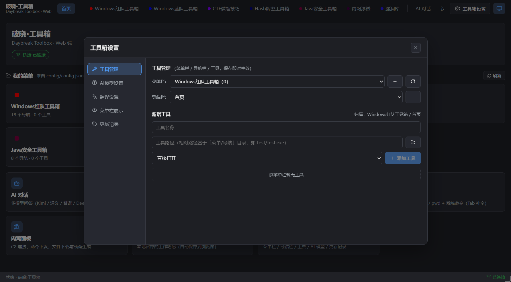
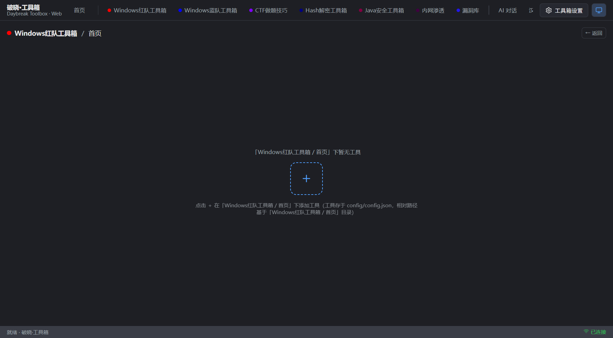
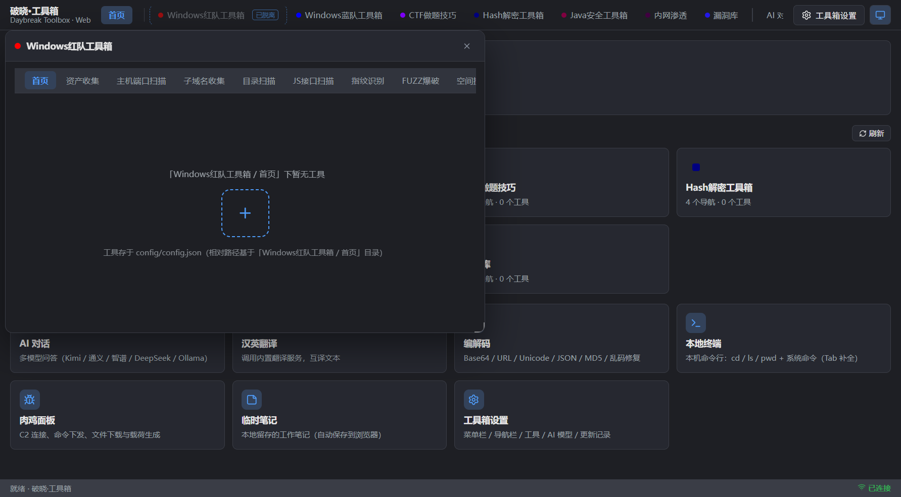
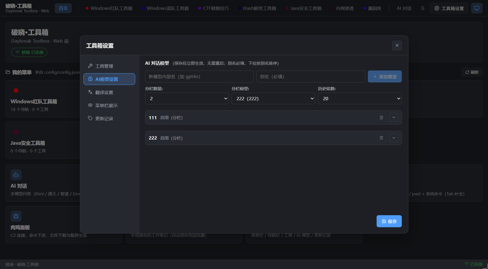
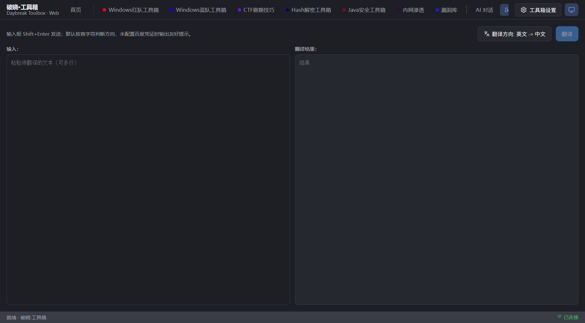
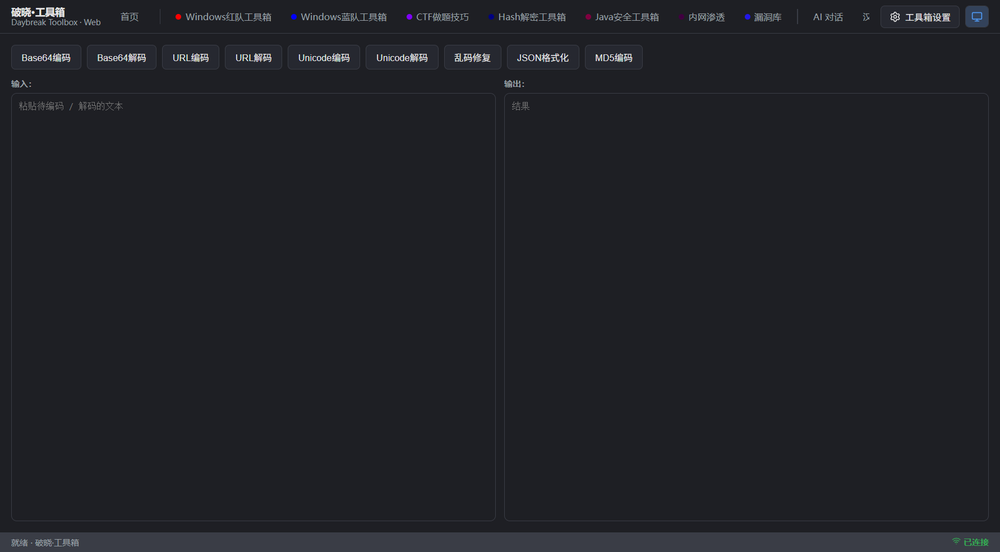
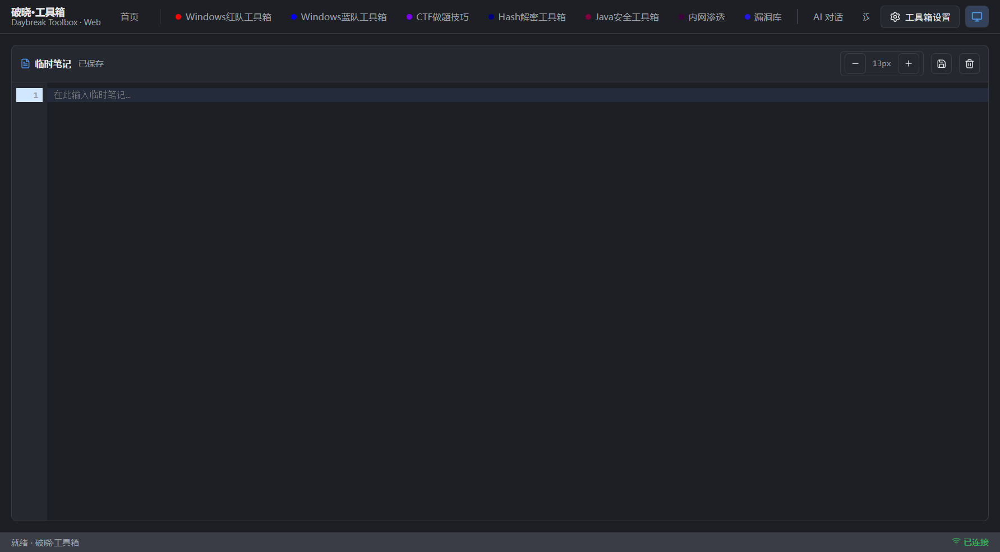

# 破晓·工具箱（Daybreak Toolbox）

GitHub地址：[Lusensec/Daybreak-Toolbox: 破晓·工具箱（Daybreak Toolbox）](https://github.com/Lusensec/Daybreak-Toolbox)

更新方法：下载或者克隆项目后，直接覆盖原有项目即可（`config/` 下的配置不会与你的工具数据冲突；旧版配置文件会在首次启动时自动迁移，无需手工处理）。

# 一、工具箱简介

一、由于从学习到实践的过程中会不断收集各种工具，对这些工具做好分类汇总，是一件繁琐且有必要的。开发这个工具箱的目的，就是让用户对工具变得更为趁手，进而打造属于自己的工具箱。

二、工具箱具备强大的多种环境应对能力，面对 Windows、Linux 等以及红队、蓝队等不同场景，依然让用户有趁手的工具可用，快速上手工作。

三、面对多种工具的各种情况，工具箱根据绝对路径、相对路径以及未安装等情况做了不同的处理（路径不存在时自动置灰）。

现在工具箱是 **Web 形态**：Python 桥接服务 + 浏览器界面，一套配置多端可用；旧版 tkinter 界面已移除（存档于 `backup/`）。

# 二、安装和启动

## 1、环境准备

- Python 3.10+（桥接服务）
- Node 18+（仅首次构建前端时需要；已含 `web/dist` 的发行包可跳过）

## 2、安装依赖

```
pip install -r requirements.txt
```

前端（已有 `web/dist` 可跳过这两步）：

```
cd web
pnpm install
pnpm build
```

## 3、启动

```
python -m bridge.main
```

启动后浏览器打开 **http://127.0.0.1:8765/** 即是完整界面（页面由桥接服务托管，自动完成鉴权，无需手动填 token）。

自检脚本（另开终端）：

```
python -m bridge.smoke
```

## 4、可执行程序版本（v2.0 起，GitHub Release 下载）

各平台安装包在仓库 [Releases](../../releases) 页：

| 平台 | 附件 | 说明 |
| --- | --- | --- |
| Windows | `Daybreak-Toolbox-<版本>-win-x64.zip` | 解压后运行 `DaybreakToolbox.exe`（托盘常驻 + 桌面悬浮球） |
| macOS | `Daybreak-Toolbox-<版本>-mac-arm64.zip` / `mac-x64.zip` | 双击 `DaybreakToolbox.app`；首次 右键→打开 绕过 Gatekeeper |
| Linux | `Daybreak-Toolbox-<版本>-linux-x64.zip` | 解压后运行 `./DaybreakToolbox`（需系统含 GTK 运行库；悬浮球/托盘仅 Windows 生效） |

行为说明：

- 程序首次启动会在 **exe 同目录** 生成 `config/`（菜单配置 / 悬浮球位置 / 更新仓库配置）；升级时已有配置不会被覆盖。
- 启动后同样打开 **http://127.0.0.1:8765/**（端口被占用时自动 +1，启动日志打印实际端口）。
- Windows：托盘图标右键 →「退出破晓工具箱」结束进程；悬浮球菜单「关闭小球」仅停球不停服务。
- 「设置 → 更新 → 检查更新」对比 GitHub 仓库 latest Release 与本地版本。


输出 `SMOKE_OK` 即全链路正常。端口被占用时自动 8765 → 8770 顺延探测。

# 三、界面总览


顶栏：动态菜单栏（色点区分，**拖拽排序**，把某个菜单**拖出顶栏**即成为独立子窗口）+ 固定功能菜单 + 主题切换（浅色/深色/跟随系统）+ 工具箱设置。

# 四、核心功能

## 1、自定义菜单栏 / 导航栏 / 工具

工具箱设置的左侧导航各页独立管理（新增行置顶 + 列表，保存即时生效）：

- **菜单栏管理**：自主添加分类，色点区分，可显隐（「菜单栏展示」页），可重命名/删除
- **导航栏管理**：挂在某个菜单栏下的细分入口，可新增/重命名/删除
- **工具管理**：在「菜单栏 / 导航栏」组合下管理工具按钮，四种启动方式：
  1. 直接打开：适合双击即可运行的 exe
  2. 命令行打开：用 `*` 占位代替工具路径，如 `python * -h`、`* -s`（必须含 `*`）
  3. 文件夹打开：打开工具所在文件夹，应对复杂场景
  4. 链接打开：填入 http(s) 地址，点击用浏览器打开（如 docker / 虚拟机里的 Web 工具）
- **通用设置**：外观主题（浅色 / 深色 / 跟随系统）；后续设置会逐步增加



路径规则：相对路径基于「工具箱根/菜单/导航」目录，方便整体备份或赠与他人；路径不存在的工具自动置灰。



## 2、菜单子窗口（拖出顶栏）

顶栏的任意菜单按钮可以**直接拖出顶栏**，变成可拖动、可拉伸（420×300 ~ 视口上限）的独立子窗口；子窗口内的导航行与主视图同款（单行按钮、可拖拽重排、右键重命名/删除）。**双击子窗口标题栏（或点 ⛶ 按钮）全屏**，再双击/再点一次还原。多个子窗口可叠放，点按钮上的「已脱离」或子窗口 ✕ 收回主视图。刷新页面即复位（UI 态不持久化）。



## 3、AI 对话模型

支持 OpenAI 兼容协议（Kimi / 通义千问 / DeepSeek / 自定义 API）、智谱、Ollama 本地模型；可配置分栏（单栏/双栏对比）与历史轮数（10–100），保存即时生效无需重启。

配置入口：工具箱设置 → AI模型设置（别名必填，可增删自定义模型，内置连接测试）。




## 4、汉英翻译（百度翻译）

内置翻译服务（自动判断中英方向）。认证信息在「工具箱设置 → 翻译设置」中填写并保存（存于 `config/bridge_secrets.json`，保存即生效，无需重启）：


- appid / 密钥：在[百度翻译开放平台](https://fanyi-api.baidu.com/)申请
- 「测试翻译」按钮会真实调用一次接口验证可用性



## 5、编解码

Base64 / URL / Unicode / JSON / MD5 / 乱码恢复。



## 6、本地终端

本机命令执行（非交互式）：内置 `cd / ls / pwd / clear / exit`，其它命令走系统 shell；支持 Tab 补全、↑↓ 历史、命令分块 + 分隔线。

**终端类型**：工具栏下拉框可切换 `cmd / PowerShell / pwsh`（按系统实际可用项探测），切换即时生效。


## 7、临时笔记

本地保存的工作笔记（自动存到浏览器 localStorage），支持搜索/替换（Ctrl+F / Ctrl-H）。



## 8、悬浮球 / 快捷键 / 更新检查

- **悬浮球**（Windows 原生）：桌面圆形小球，右键展开/收起菜单、拖拽移动自动保存位置、置顶/隐藏（设置 → 其他设置）；「**页面**」组可一键打开 首页 / AI 对话 / 终端管理 / 编解码 / 汉英翻译 / 临时笔记 的系统页子窗口。
- **快捷键**（设置 → 快捷键设置）：支持**任意键**（可不带 Ctrl，如 `K`、`F5`、`空格` 或带修饰键的组合）；悬浮球显示/隐藏为单一 toggle 键（按一次显示、再按一次隐藏）。
- **更新检查**（设置 → 更新检查）：对比本地版本与 GitHub 仓库 latest Release，展示更新记录。

# 五、配置文件

| 文件 | 内容 | 是否随仓库 |
| --- | --- | --- |
| `config/config.json` | 菜单栏 / 导航栏 / 工具 定义（核心数据） | 是（含你的工具） |
| `config/ball_pos.json` | 悬浮球位置 + 置顶/隐藏状态 | 是（默认值，运行中自动更新） |
| `config/ai.json` | AI 模型配置 + 历史轮数（含 API key） | 否（gitignore） |
| `config/bridge_secrets.json` | 桥接 token + 百度翻译凭证（合并单文件） | 否（gitignore） |
| `config/ssh_hosts.json` | SSH 主机表（含明文密码） | 否（gitignore，严禁随仓库分发） |
| `config/shortcuts.json` | 全局快捷键组合（个人偏好） | 否（gitignore，缺省用内置默认） |

**自动迁移**：首次启动会把旧版文件合并进新结构，之后旧文件即可安全删除——
`ai_ask.json` + `ai_history.json` → `ai.json`；`bridge_token.json` + `baidu.py` → `bridge_secrets.json`。

# 六、安全说明

- 桥接服务**仅监听 127.0.0.1**，不对外暴露；WS/REST 均需随机 token（启动时自动生成并持久化）
- 所有密钥（AI API key、百度凭证、桥接 token）只存本地 gitignored 文件，不进仓库
- 工具箱本身是学习研究工具，请仅对你有权限的系统使用

# 七、更新记录

## v2.0.1

1、工具箱设置左侧导航拆分：新增「通用设置」（默认打开，深色/浅色/跟随系统主题切换），菜单栏管理、导航栏管理、工具管理各自独立成页（新增行置顶 + 列表管理），工具画布移除「← 返回」
2、子窗口体验：双击标题栏 / ⛶ 按钮全屏（工具箱设置同），修复子窗口被设置弹窗遮挡的层级问题
3、悬浮球新增「页面」组：一键打开 6 个系统页子窗口（首页 / AI 对话 / 终端管理 / 编解码 / 汉英翻译 / 临时笔记）；修复窗口缩小时球坐标越界
4、快捷键支持任意键（可不带 Ctrl，如 K / F5 / 空格或修饰键组合）；悬浮球显示/隐藏合并为单一 toggle 键
5、重命名美化：菜单栏/导航栏重命名改用全局模态对话框（Enter 确定 / Esc 取消），替换原生 prompt；菜单与导航右键新增「添加菜单栏」直达设置
6、终端管理：点击输出区不再抢占输入框焦点，复制结果更顺手
7、性能：页面级懒加载拆分主包（~305KB），移除未使用的 react-markdown 依赖
8、「更新设置」菜单项更名「更新检查」

更早版本的记录见各 [Release](../../releases) 说明与程序内「更新检查」页。
