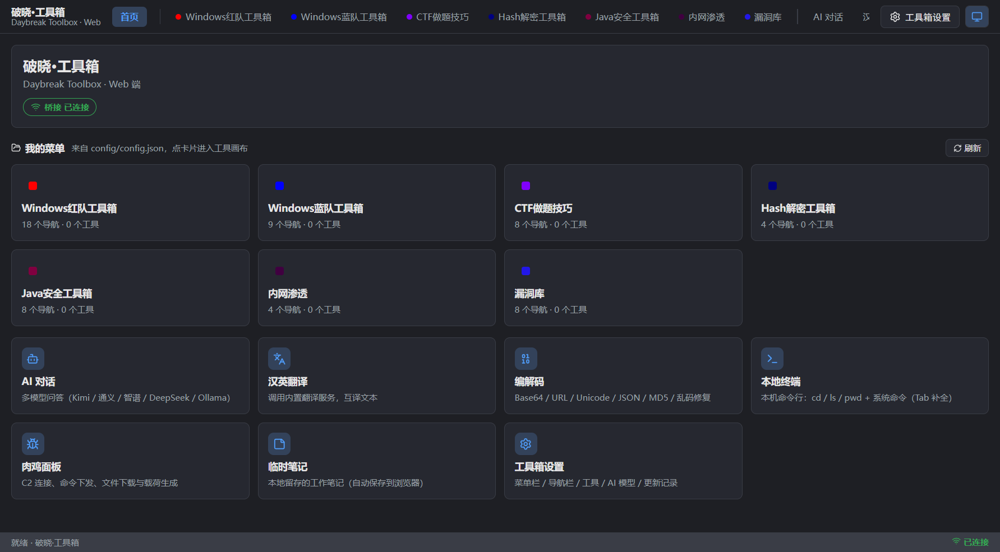
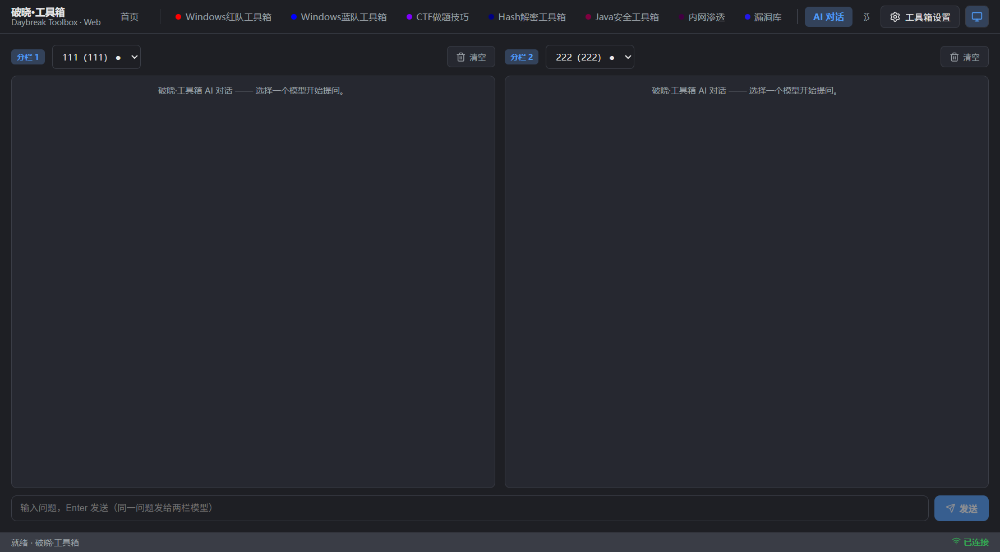
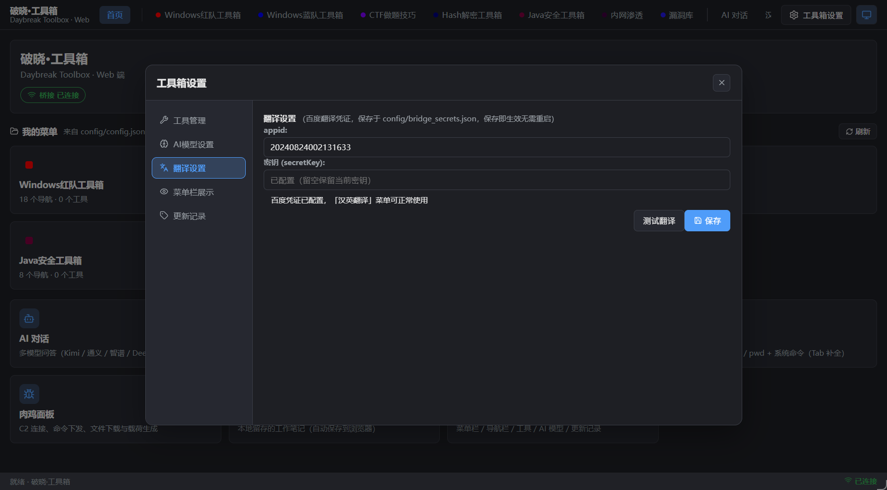
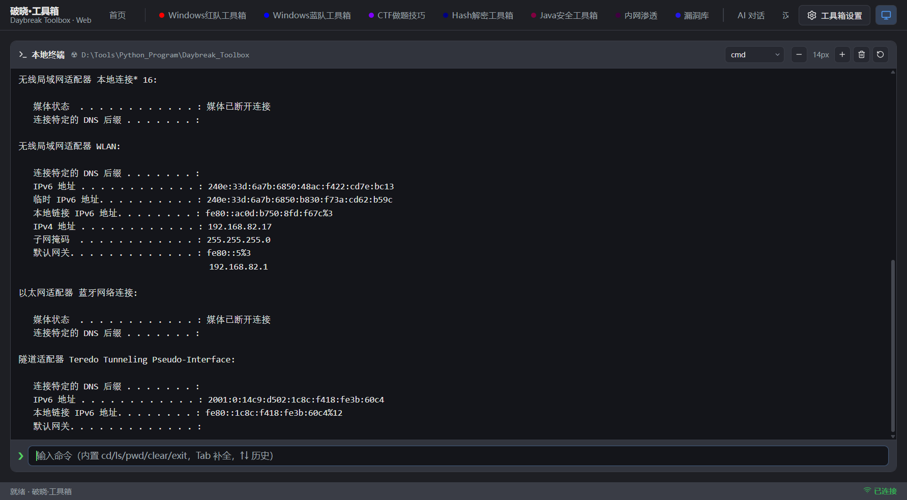

# 破晓·工具箱（Daybreak Toolbox）

GitHub地址：[Lusensec/Daybreak-Toolbox: 破晓·工具箱（Daybreak Toolbox）](https://github.com/Lusensec/Daybreak-Toolbox)

更新方法：下载或者克隆项目后，直接覆盖原有项目即可（`config/` 下的配置不会与你的工具数据冲突；旧版配置文件会在首次启动时自动迁移，无需手工处理）。

# 一、工具箱简介

一、由于从学习到实践的过程中会不断收集各种工具，对这些工具做好分类汇总，是一件繁琐且有必要的。开发这个工具箱的目的，就是让用户对工具变得更为趁手，进而打造属于自己的工具箱。

二、工具箱具备强大的多种环境应对能力，面对 Windows、Linux 等以及红队、蓝队等不同场景，依然让用户有趁手的工具可用，快速上手工作。

三、面对多种工具的各种情况，工具箱根据绝对路径、相对路径以及未安装等情况做了不同的处理（路径不存在时自动置灰）。

现在工具箱是 **Web 形态**：Python 桥接服务 + 浏览器界面，一套配置多端可用；旧版 tkinter 界面已移除（存档于 `backup/`）。

# 二、安装和启动

## 1、环境准备

- Python 3.10+（桥接服务）
- Node 18+（仅首次构建前端时需要；已含 `web/dist` 的发行包可跳过）

## 2、安装依赖

```
pip install -r requirements.txt
```

前端（已有 `web/dist` 可跳过这两步）：

```
cd web
pnpm install
pnpm build
```

## 3、启动

```
python -m bridge.main
```

启动后浏览器打开 **http://127.0.0.1:8765/** 即是完整界面（页面由桥接服务托管，自动完成鉴权，无需手动填 token）。

自检脚本（另开终端）：

```
python -m bridge.smoke
```

## 4、可执行程序版本（v2.0 起，GitHub Release 下载）

各平台安装包在仓库 [Releases](../../releases) 页：

| 平台 | 附件 | 说明 |
| --- | --- | --- |
| Windows | `Daybreak-Toolbox-<版本>-win-setup.exe`（**v2.0.9 起推荐**：安装程序，安装时可选路径，默认 `%LOCALAPPDATA%\DaybreakToolbox` 免管理员，含快捷方式/卸载项）或 `Daybreak-Toolbox-<版本>-win-x64.zip`（绿色版：解压后运行 `DaybreakToolbox.exe`） | 直接弹出原生应用窗口（v2.0.3 起，WebView2 渲染；托盘常驻；v2.0.8 起无边框窗口，窗口操作在顶栏） |
| macOS | `Daybreak-Toolbox-<版本>-mac-arm64.zip` / `mac-x64.zip` | 双击 `DaybreakToolbox.app`；首次 右键→打开 绕过 Gatekeeper（窗口形态依赖系统 WebView；缺失时自动降级浏览器） |
| Linux | `Daybreak-Toolbox-<版本>-linux-x64.zip` | 解压后运行 `./DaybreakToolbox`（需系统含 GTK/WebKit 运行库；无窗口引擎时降级浏览器形态；托盘仅 Windows 生效） |

行为说明：

- 程序首次启动会在 **exe 同目录** 生成 `config/`（菜单配置 / 更新仓库配置）；升级时已有配置不会被覆盖。
- **窗口形态（v2.0.3 起默认）**：exe 启动后弹出应用窗口即完整界面（与浏览器同款 UI）；**v2.0.8 起为无边框窗口**（无原生标题栏，窗口操作在顶栏：拖移/双击最大化/右下角拉伸/顶栏右侧关闭 X）；关闭窗口 = 退出进程（托盘「退出破晓工具箱」同义；任务栏关闭 / Alt+F4 亦可退出）。
- **服务模式**：加参数 `DaybreakToolbox.exe --service`（或窗口引擎不可用时自动降级）→ 无常驻窗口，启动约 1 秒后自动打开默认浏览器访问 **http://127.0.0.1:8765/**（端口被占用时自动 +1，`daybreak.log` 打印实际端口）。
- Windows：托盘图标右键 →「退出破晓工具箱」结束进程。
- 「设置 → 更新检查」对比 GitHub 仓库 latest Release 与本地版本。


输出 `SMOKE_OK` 即全链路正常。端口被占用时自动 8765 → 8770 顺延探测。

# 三、界面总览



顶栏：动态菜单栏（色点区分，**拖拽排序**，把某个菜单**拖出顶栏**即成为独立子窗口）+ 固定功能菜单 + 主题切换（浅色/深色/跟随系统）+ 工具箱设置。

# 四、核心功能

## 1、自定义菜单栏 / 导航栏 / 工具

工具箱设置的左侧导航各页独立管理（新增行置顶 + 列表，保存即时生效）：

- **菜单栏管理**：自主添加分类，色点区分，可显隐（「菜单栏展示」页），可重命名/删除
- **导航栏管理**：挂在某个菜单栏下的细分入口，可新增/重命名/删除
- **工具管理**：在「菜单栏 / 导航栏」组合下管理工具按钮，四种启动方式：
  1. 直接打开：适合双击即可运行的 exe
  2. 命令行打开：用 `*` 占位代替工具路径，如 `python * -h`、`* -s`（必须含 `*`）
  3. 文件夹打开：打开工具所在文件夹，应对复杂场景
  4. 链接打开：填入 http(s) 地址，点击用浏览器打开（如 docker / 虚拟机里的 Web 工具）
- **通用设置**：外观主题（浅色 / 深色 / 跟随系统）；后续设置会逐步增加


路径规则：相对路径基于「工具箱根/菜单/导航」目录，方便整体备份或赠与他人；路径不存在的工具自动置灰。


## 2、菜单子窗口（拖出顶栏）

顶栏的任意菜单按钮可以**直接拖出顶栏**，变成可拖动、可拉伸（420×300 ~ 视口上限）的独立子窗口；子窗口内的导航行与主视图同款（单行按钮、可拖拽重排、右键重命名/删除）。**双击子窗口标题栏（或点 ⛶ 按钮）全屏**，再双击/再点一次还原。多个子窗口可叠放，点按钮上的「已脱离」或子窗口 ✕ 收回主视图。刷新页面即复位（UI 态不持久化）。


## 3、AI 对话模型

支持 OpenAI 兼容协议（Kimi / 通义千问 / DeepSeek / 自定义 API）、智谱、Ollama 本地模型；可配置分栏（单栏/双栏对比）与历史轮数（10–100），保存即时生效无需重启。

配置入口：工具箱设置 → AI模型设置（别名必填，可增删自定义模型，内置连接测试）。




## 4、汉英翻译（百度翻译）

内置翻译服务（自动判断中英方向）。认证信息在「工具箱设置 → 翻译设置」中填写并保存（存于 `config/bridge_secrets.json`，保存即生效，无需重启）：



- appid / 密钥：在[百度翻译开放平台](https://fanyi-api.baidu.com/)申请
- 「测试翻译」按钮会真实调用一次接口验证可用性


## 5、编解码

Base64 / URL / Unicode / JSON / MD5 / 乱码恢复。


## 6、本地终端

本机命令执行（非交互式）：内置 `cd / ls / pwd / clear / exit`，其它命令走系统 shell；支持 Tab 补全、↑↓ 历史、命令分块 + 分隔线。

**终端类型**：工具栏下拉框可切换 `cmd / PowerShell / pwsh`（按系统实际可用项探测），切换即时生效。



## 7、临时笔记

本地保存的工作笔记（自动存到浏览器 localStorage），支持搜索/替换（Ctrl+F / Ctrl-H）。


## 8、快捷键 / 更新检查

- **快捷键**（设置 → 快捷键设置）：支持**任意键**（可不带 Ctrl，如 `K`、`F5`、`空格` 或带修饰键的组合）。
- **更新检查**（设置 → 更新检查）：对比本地版本与 GitHub 仓库 latest Release，展示更新记录。

# 五、配置文件

| 文件 | 内容 | 是否随仓库 |
| --- | --- | --- |
| `config/config.json` | 菜单栏 / 导航栏 / 工具 定义（核心数据） | 是（含你的工具） |
| `config/ai.json` | AI 模型配置 + 历史轮数（含 API key） | 否（gitignore） |
| `config/bridge_secrets.json` | 桥接 token + 百度翻译凭证（合并单文件） | 否（gitignore） |
| `config/ssh_hosts.json` | SSH 主机表（含明文密码） | 否（gitignore，严禁随仓库分发） |
| `config/shortcuts.json` | 全局快捷键组合（个人偏好） | 否（gitignore，缺省用内置默认） |

**自动迁移**：首次启动会把旧版文件合并进新结构，之后旧文件即可安全删除——
`ai_ask.json` + `ai_history.json` → `ai.json`；`bridge_token.json` + `baidu.py` → `bridge_secrets.json`。

# 六、安全说明

- 桥接服务**仅监听 127.0.0.1**，不对外暴露；WS/REST 均需随机 token（启动时自动生成并持久化）
- 所有密钥（AI API key、百度凭证、桥接 token）只存本地 gitignored 文件，不进仓库
- 工具箱本身是学习研究工具，请仅对你有权限的系统使用

# 七、更新记录

## v2.1.1

启动性能优化：双击到界面可用 **5.0s → 约 3.0s**（同机实测 2.96–3.65s）。

1、打包方式 `onefile` → `onedir`：去掉每次启动把 394 个文件 / 63MB 解压到 `%TEMP%` 的开销（实测独占 3.0s，且每个文件都要过杀软实时扫描）；顺带不再残留 `_MEI` 临时目录、进程数减半（无 bootloader 父进程）
2、WebView2 改用持久化 profile（`data/webview2-<版本>`）：不再每次启动重建临时缓存目录（减少数百个缓存文件的写入与扫描）；目录带版本后缀，升级自动换新，避免旧 `index.html` 缓存导致界面不更新。对启动耗时本身贡献很小（~0.03s），剩余约 1.2s 是 WebView2 环境与浏览器进程创建，不是缓存能省的
3、新增单实例守卫（命名互斥量）：重复双击不再起第二个完整实例（约 1.4s 内退出），而是唤回已有窗口并置前
4、安装包与 zip 分发包随产物改为目录结构：安装包递归安装 `_internal/`，zip 解压得到单一文件夹（README 在内）

## v2.1.0

窗口形态定版（合并 v2.0.19 + v2.0.20 全部成果）：

1、窗口尺寸固定为主屏工作区的 80% 并居中，取消边缘/角落拖拽拉伸（`resizable=False` + 尺寸钳制双保险），仅保留 最大化/还原 与关闭；顶栏拖动移动、双击顶栏最大化保留
2、修复点击左上角品牌区黑屏/白屏（v2.0.19 回归）：`WM_SETREDRAW` 挂起只作用于顶层窗体、单击（位移 < 3px）不发任何窗口命令、禁止 logo 图片原生拖拽（其会吞掉 `mouseup` 导致重绘永不恢复）
3、顶栏信息精简：移除底部「就绪 · 破晓·工具箱 / 已连接」整行，连接状态移到顶栏版本号右侧（在线 / 重连中 / 连接中 / 未连接 + 图标），主内容区多出 28px
4、版本号改为椭圆胶囊样式（强调色浅底 + 同色系文字），品牌区两行结构：标题 / 版本号 + 连接状态
5、Windows 边框拖拽闪烁根治：拖拽期间挂起重绘、收尾一次性刷新 + 3s 看门狗；打包版 `SetWindowSubclass` 失败自动走 `SetWindowLongPtrW` 兜底（关闭后最小化 / 背景色同步 / MinimumSize 归一化在 exe 真正生效）；钩子全失败时 `SetClassLongPtrW` 类画刷兜底露底色；前端几何按实测 RTT 自适应节流

## v2.0.20

窗口形态与顶栏信息精简：
1、窗口尺寸固定为主屏工作区的 80% 并居中，取消边缘/角落拖拽拉伸（`resizable=False` + 尺寸钳制双保险），仅保留 最大化/还原 与关闭
2、修复点击左上角品牌区黑屏/白屏：v2.0.19 的 `WM_SETREDRAW` 挂起会冻死 WebView2 合成，现改为只挂起顶层窗体；单击（位移 < 3px）不发任何窗口命令；禁止 logo 图片原生拖拽（其会吞掉 `mouseup`）
3、移除底部状态栏（「就绪 · 破晓·工具箱」/ 已连接），连接状态移到顶栏品牌区版本号右侧（在线 / 重连中 / 连接中 / 未连接 + 图标）
4、版本号改为椭圆胶囊样式（强调色浅底 + 同色系文字），品牌区两行结构：标题 / 版本号 + 连接状态

## v2.0.19

Windows 边框拖拽拉伸闪烁根治：
1、拖拽/拉伸开始时挂起窗口及 WebView2 子窗口重绘（WM_SETREDRAW），结束时补发最终几何再一次性整体刷新，消除「外框已变、内容未合成」的露底闪烁；附带 3s 看门狗，页面崩溃 / WS 断线也不会让窗口永久冻结
2、frozen（打包 exe）下 Win32 消息钩子失败修复：SetWindowSubclass 静默失败时自动改走 SetWindowLongPtrW(GWLP_WNDPROC) 兜底，关闭后最小化 / 背景色同步 / MinimumSize 归一化在打包版真正生效
3、背景色兜底不依赖钩子：钩子两条路径都失败时改 SetClassLongPtrW(GCLP_HBRBACKGROUND) 设置窗口类画刷，露底条仍与主题同色（不再白闪）
4、前端拖拽按实测 RTT 自适应节流（RTT>16ms 降频给 WebView2 留合成时间），几何公式 onMove/onUp 共用，收尾补发最终位置保证窗口精确停在光标处

## v2.0.18

窗口体验三项优化：
1、顶栏左上/右上角新增 14×14 斜向拉伸区（紧贴顶栏下方；光标 nesw/nwse，hover 斜纹提示，与下缘角落同构）
2、拖拽拉伸闪烁根因修复：显示器信息 30s 缓存（免每帧枚举）、几何不变帧 no-op 免 Win32 重入、MinimumSize 按窗口显示器缩放等比归一（消除 >100% 缩放回跳）、流式 SetWindowPos 去 SWP_SHOWWINDOW；v2.0.17 三项（无每帧 ShowWindow / 背景色随主题 / 单笔在途背压）不回退
3、顶栏品牌区展示版本号（单一来源 update_service.APP_VERSION 经 app.env 下发；不可用/旧桥接不渲染）

## v2.0.17

Windows 安装/卸载界面中文化 + 修复下边框拉伸闪烁晃动：
1、win-setup.exe 安装向导与卸载对话框改为简体中文（官方 Inno 中文语言文件）
2、下边框上压缩窗口闪烁/晃动修复：流式路径去每帧 ShowWindow、WinForms 最小尺寸归一化（100% 屏尺寸回跳）、窗体背景色随主题同步（露底同色）、拖拽/拉伸流单笔在途背压

## v2.0.16

修复拖动主窗口延迟与左右晃动：
1、顶栏拖拽/边缘拉伸的窗口几何应用不再串行等 120ms（旧版拖动脉动 ~8Hz + 命令队列堵满 → 其他功能加载超时）
2、直接 Win32 SetWindowPos 同步连发安全，拖拽 60fps 跟手；120ms 落定仅保留给最大化/还原

## v2.0.15

新增「关闭后进入最小化」通用设置：
1、工具箱设置 → 通用设置 → 窗口：「关闭后进入最小化」开关（持久化 config/settings.json，即时生效）
2、开启后 顶栏 × / Alt+F4 → 最小化驻留托盘（进程不退出），托盘「打开…」唤回；托盘「退出破晓工具箱」为真正退出
3、托盘「打开…」优先唤回已有窗口（无窗口回退浏览器，旧行为）；X 按钮提示随设置动态变化

## v2.0.14

性能与多屏优化：
1、**混合 DPI 多屏修复**：窗口移动/最大化/边缘拉伸改 per-monitor scale 精确坐标模型（不同缩放双屏拖窗口不再漂移；move/resize 一并原子化）
2、**托盘启动全后台化**（启动提速 0.2–0.5s）+ 各阶段 `[perf]` 计时入日志
3、CI 增加**测试门禁**（全量 pytest + 前端构建 → 卡 5 个平台构建）

## v2.0.13

全面清理：移除已退役旧版功能的文档/记录残留（功能本体早已在 v2.0.0 架构重构中移除）：
1、删除过时的《React_TS_UI 重构方案》设计文档（描述的旧 tkinter 架构与 C2 协议已退役）
2、更新记录面板移除 v1.x 旧版条目，仅保留 v2.0.x 及以后
3、.gitignore 清除旧运行时产物规则残留

## v2.0.12

轻量优化与稳健性修复（行为不变）：
1、临时笔记行号槽改**增量更新**（旧版每次击键全量重建行号 DOM，长笔记卡顿；现仅行数/主题/字号变化才重建，光标移动 O(1)）
2、下载链接改 **1MB 分块流式写盘**（旧版整文件入内存；失败自动清理残留部分文件）
3、AI 会话键**上限 50**（LRU 淘汰，托盘常驻数天内存有界）
4、桥接 10s 未就绪：窗口模式**不再开空白窗口**（降级浏览器 + 日志告警）；服务模式补告警

## v2.0.11

轻量优化（行为不变，减内存/CPU/磁盘负担）：
1、`daybreak.log` 改**滚动日志**（单文件 ≤5MB、保留 2 份备份）——托盘常驻数天磁盘占用封顶 ~15MB
2、WS 总线每连接待处理命令**上限 512**（超出拒收 `WS_QUEUE_FULL`），异常客户端/慢命令堆积时内存有界
3、WS 帧上限校验**快路径**（普通小帧免 utf-8 编码分配）

## v2.0.10

1、最大化/还原改为**几何驱动**（幂等自愈）：不再依赖状态标志——页面重载、任务栏最小化往返、最大化中手动改大小后，按钮依旧可靠（修复 v2.0.9「第二次点击起失效」）
2、顶栏窗口控件图标修正：**最小化=「—」**（原斜箭图标易误认）、最大化=⤢、还原=叠方
3、**全边缘拉伸**：左/右/下边缘任意位置 + 左下/右下角均可拖动调整窗口大小（v2.0.8–v2.0.9 仅右下角）；最大化中拖边缘自动还原后拉伸；最小 960×600 双保险钳制

## v2.0.9

1、Windows 安装程序（Inno Setup）：Release 新增 **win-setup.exe** 安装程序（安装时可选路径，默认 `%LOCALAPPDATA%\DaybreakToolbox` 免管理员；开始菜单/桌面快捷方式 + 卸载项）；原 zip 绿色版保留
2、顶栏右侧新增 **最小化** 按钮（-），窗口控件顺序 最小化 / 最大化·还原 / 关闭
3、修复 v2.0.8 最大化卡死 bug（多次点击切换无效果）：显示器枚举回调参数错位 + 原生/手动最大化状态失步，现统一为原生状态转换 + 工作区钳制
4、移除顶栏主题切换按钮：主题统一在「工具箱设置 → 通用设置 → 外观」配置，顶栏 Logo 自动跟随

## v2.0.8

1、无边框窗口形态：移除 exe 原生标题栏（全平台窗口形态统一），窗口观感回归 web 自定义顶栏
2、顶栏右侧（主题切换右边）新增 **最大化/还原 + 关闭 X**：X 关闭整个应用（与托盘「退出破晓工具箱」同义）
3、顶栏品牌区/栏间隙 按住拖动移动窗口、双击最大化；右下角小三角拉伸缩放（最小 960×600）
4、浏览器/服务形态顶栏保持原样（窗口控件仅在无边框窗口形态渲染）

## v2.0.7

1、移除悬浮球功能：原生 Win32 置顶球、`ball.*` WS 命令/事件、设置页「悬浮球」开关与「其他设置」标签页、全局快捷键 `ball:show`、托盘「显示悬浮球」项、`config/ball_pos.json` 位置持久化、球体图标资产全部移除
2、快捷键旧数据自动迁移：旧版本 `config/shortcuts.json` 中的 `ball:show` / `ball:hide` 条目读取时静默丢弃，无需手工清理

## v2.0.6

1、悬浮球统一为「全局球」：屏幕上只保留 bridge 进程运行的原生置顶球一颗（可拖动到屏幕任意位置、位置记忆、跟随系统深浅色主题、左键聚焦主应用窗口、右键菜单隐藏/置顶/关闭）
2、球外观换回「完整 Logo 徽标」（深色系统用藏青徽标、浅色系统用米白徽标；v2.0.5 的简化球图标降为兜底）
3、移除页内 web 悬浮球及其快捷面板（页面/工具快启/子窗口）：应用窗口内不再有第二颗球
4、设置页「悬浮球」开关与全局快捷键 ball:show 收敛为控制这一颗全局球

## v2.0.5

1、悬浮球改造：全新简化球图标（藏青 / 米白双主题，大号交叉工具、无小齿轮）；球体自动跟随 Windows 系统深浅色主题切换
2、悬浮球左键：窗口形态下改为聚焦 / 还原主应用窗口（服务形态仍开浏览器），不再多开浏览器界面
3、修复悬浮球右键菜单闪烁 / 状态错乱：多条触发路径统一收敛为单一 400ms 去抖 toggle
4、修复悬浮球拖拽卡顿：改为直接移动 + 表面重提交（不再逐次重建窗口），抓取区扩大（点球边缘也能抓起）
5、修复悬浮球拖到右下角越屏 + 重启后位置弹回默认位：拖拽钳制按窗口全宽修正，启动越界钳制改为保留用户位置，拖拽中周期落盘
6、说明：v2.0.4 起 exe 已内置「破晓」图标（已验证嵌入）；若资源管理器中仍显示旧的默认图标，为 Windows 图标缓存所致——换一个新文件夹解压（或清理图标缓存 / 重启资源管理器）即可显示新图标

## v2.0.4

1、Windows 图标修复：exe 文件图标 / 窗口标题栏 / 任务栏 / 资源管理器均换成「破晓」系统 Logo（此前为 Python 打包默认图像）
2、浅色模式 Logo 统一：顶栏左上角 Logo 与浏览器标签 favicon 在浅色主题下改用浅色 Logo（深色主题沿用深色 Logo，与悬浮球一致）
3、修复打包版悬浮球 / 托盘在 zip 目录运行时显示手绘兜底图标的问题：改为读取内置真 Logo

## v2.0.3

1、新增窗口形态（Windows 打包默认）：双击 exe 直接弹出原生应用窗口（WebView2 渲染，与浏览器界面同款），关闭窗口即退出；托盘 / 悬浮球与窗口共存
2、`--service` 参数（或窗口引擎不可用时）回退旧形态：常驻服务 + 自动打开默认浏览器，行为同 v2.0.2
3、Windows 包内置 pywebview / pythonnet / WebView2 interop DLL；macOS / Linux 包窗口引擎缺失时自动降级浏览器形态

## v2.0.2

1、修复打包版启动后不自动打开浏览器：exe 启动约 1 秒后自动用默认浏览器打开界面地址（开发态不受影响；失败时日志打印手动地址）
2、修复原生悬浮球不可见：位置越界（旧配置 / 换屏 / 默认值越界）时自动钳制到主屏工作区右下角；仓库默认位置改为 (1860, 940)
3、Windows 包内置 pywin32（悬浮球渲染走 win32gui 快速路径）；win32gui 缺失提示只打一次，不再逐帧刷日志

## v2.0.1

1、工具箱设置左侧导航拆分：新增「通用设置」（默认打开，深色/浅色/跟随系统主题切换），菜单栏管理、导航栏管理、工具管理各自独立成页（新增行置顶 + 列表管理），工具画布移除「← 返回」
2、子窗口体验：双击标题栏 / ⛶ 按钮全屏（工具箱设置同），修复子窗口被设置弹窗遮挡的层级问题
3、悬浮球新增「页面」组：一键打开 6 个系统页子窗口（首页 / AI 对话 / 终端管理 / 编解码 / 汉英翻译 / 临时笔记）；修复窗口缩小时球坐标越界
4、快捷键支持任意键（可不带 Ctrl，如 K / F5 / 空格或修饰键组合）；悬浮球显示/隐藏合并为单一 toggle 键
5、重命名美化：菜单栏/导航栏重命名改用全局模态对话框（Enter 确定 / Esc 取消），替换原生 prompt；菜单与导航右键新增「添加菜单栏」直达设置
6、终端管理：点击输出区不再抢占输入框焦点，复制结果更顺手
7、性能：页面级懒加载拆分主包（~305KB），移除未使用的 react-markdown 依赖
8、「更新设置」菜单项更名「更新检查」

更早版本的记录见各 [Release](../../releases) 说明与程序内「更新检查」页。
